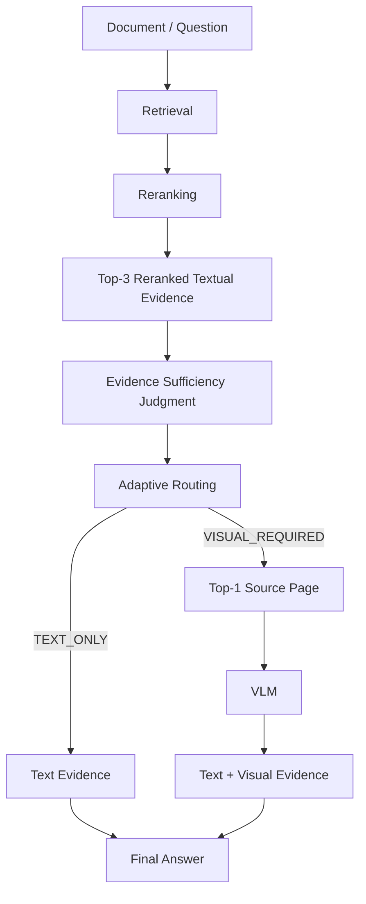
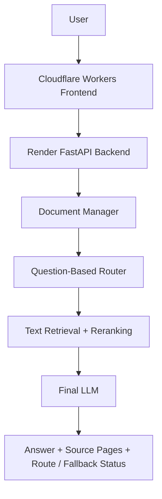

# Adaptive Multimodal RAG

> Retrieval-Aware Routing for Document Question Answering

Adaptive Multimodal RAG evaluates whether retrieved text evidence is sufficient to answer a PDF
question before invoking a vision-language model (VLM). The completed ACK 2026 study evaluated
this approach on 1,600 UniDoc-Bench questions, observing lower Vision usage and mean latency with
a small difference in answer accuracy relative to Forced Vision. This repository also provides a
PDF question-answering web demo with source-page inspection; its deployment behavior is described
separately below.

[Live Demo](https://winter666-hub-furiosa-multimodal-rag-frontend.winter666.workers.dev) ·
[Backend](https://furiosa-multimodal-rag.onrender.com) ·
[GitHub](https://github.com/winter666-hub/furiosa-multimodal-rag)

## Research Overview

PDF documents contain prose, tables, figures, graphs, and diagrams. Applying Vision inference to
every question adds computation and latency, while text-only processing can miss visual evidence.
The ACK research question is whether the sufficiency of retrieved textual evidence can guide
selective Vision inference while largely retaining the answer accuracy of an always-on visual
path.

The contribution is evidence-sufficiency-based routing after retrieval and reranking. The system
uses existing language and vision models and evaluates two actions: `TEXT_ONLY` and
`VISUAL_REQUIRED`.

## ACK 2026 — Research Pipeline



Retrieval and reranking run first. The router then receives the question and up to three reranked
text chunks, which may come from fewer than three distinct pages. It selects `TEXT_ONLY` when
that evidence is sufficient, or `VISUAL_REQUIRED` when additional visual evidence is needed.
The visual path inspects the single physical PDF page containing the highest-ranked source chunk.
The final language model generates an answer from the textual evidence and any available
VLM-derived evidence.

The research path is implemented by
[`RetrievalAwareRagPipeline`](src/furiosa_rag/pipeline.py) and
[`RetrievalAwareAdaptiveRouter`](src/furiosa_rag/router.py).

## ACK 2026 — Main Research Evaluation

The main evaluation used **1,600 UniDoc-Bench questions across eight domains**: 400 each of
`text_only`, `image_only`, `table_required`, and `image_plus_text_as_answer`. All three methods
were evaluated on the same question set.

| Method | Accuracy | Vision Call Rate | Mean E2E Latency |
|---|---:|---:|---:|
| Forced Text | 58.25% | 0.00% | 5.740 s |
| Forced Vision | 64.00% | 100.00% | 10.299 s |
| Adaptive / Retrieval-Aware | 63.63% | 46.81% | 8.268 s |

Forced Text answers from retrieved text without Vision. Forced Vision invokes the VLM on the
Top-1 source page for every question. Adaptive / Retrieval-Aware selects between those paths
after judging the reranked text evidence.

**Evaluation protocol.** Accuracy is reference-based LLM-judge answer correctness: a correctness
score of at least 3 on a 0–4 scale, judged with `furiosa-ai/Qwen3-32B-FP8`. The correct-answer
counts are 932, 1,024, and 1,018 out of 1,600, respectively. This metric is separate from routing
accuracy in the earlier pilot benchmarks. Vision Call Rate uses all 1,600 questions as its
denominator: 0, 1,600, and 749 Vision calls. Mean E2E latency is the arithmetic mean of the
per-question execution times with warm document-index caches. It includes retrieval, reranking,
routing when applicable, page rendering and Vision when used, and answer generation; PDF indexing
and the separate answer-quality judging step are outside this measurement.

Relative to Forced Vision, Adaptive / Retrieval-Aware used **53.19% fewer Vision calls** and
reduced **mean E2E latency by 19.72%**, with an accuracy difference of approximately
**−0.38 percentage points** (six fewer correct answers).

The paired McNemar test reported **p = 0.679**. The paired question-level bootstrap 95% confidence
interval for the accuracy difference (Adaptive − Forced Vision) was **−1.88 to +1.06 percentage
points**. This comparison did not detect a statistically significant difference; it does not
establish equivalence or non-inferiority. The observed accuracy was close to Forced Vision's,
with reduced Vision usage and mean latency. These are research-run measurements, not live-demo
performance guarantees.

### Contributions

- Evidence-sufficiency-based routing after retrieval and reranking.
- Selective `TEXT_ONLY` / `VISUAL_REQUIRED` inference using existing text and vision models.
- Quantitative comparison of Forced Text, Forced Vision, and Retrieval-Aware routing on 1,600
  UniDoc-Bench questions.
- An observed accuracy–efficiency trade-off: substantially fewer Vision calls and lower mean
  latency while largely retaining Forced Vision's answer accuracy.

### Research Limitations

- The visual path uses only the Top-1 source page. Useful evidence on another page can be missed.
- Answer quality depends on retrieval and reranking quality, evidence-sufficiency judgment, and
  visual evidence selection; these components can make errors.
- Binary routing does not guarantee the optimal Vision decision for every question.
- These results do not establish multi-page reasoning, optimal automatic page selection, or the
  superiority of general agent-based action selection.
- Accuracy depends on a reference-based LLM judge, and absolute latency depends on the model
  serving and network conditions of the measured runs.

## Public Demo

The public service uses **Cloudflare Workers + Render** in `hosted_only` mode. It reports
`TEXT_ONLY` or `VISUAL_REQUIRED`, and a `VISUAL_REQUIRED` request is answered through
**Text-RAG fallback** with `fallback_used=true`. Direct NPU Vision is not enabled in this
deployment.

The current web implementation uses `AdaptiveQueryRouter`: explicit visual rules and a
question-based LLM fallback run before the text RAG pipeline. The ACK evidence-sufficiency path
above uses retrieved and reranked evidence to route. The public service is therefore a separate
deployment configuration from the evaluated research pipeline.



Document preparation is isolated per uploaded PDF:

```text
PDF upload
  -> Text extraction
  -> Chunking
  -> Embedding
  -> Document-specific cache
  -> Question answering
```

RAG has four roles here: **retrieval** finds relevant PDF chunks, **augmentation** gives those
chunks to the final LLM, **generation** produces an evidence-bound answer, and **verification**
lets the user inspect one-based source pages and retrieved passages.

### Demo Features

- Arbitrary PDF upload, SHA-256 IDs, path-safe isolation, and duplicate cache reuse
- Retrieval, reranking, adaptive routing, and evidence-grounded generation
- Source-page buttons, referenced passages, responsive text highlights, and PDF replacement
- Process-local rate/concurrency limits and bounded TTL/storage cleanup
- Trusted Cloudflare-to-Render client-IP forwarding with a shared proxy secret

### Usage

1. Open the [live demo](https://winter666-hub-furiosa-multimodal-rag-frontend.winter666.workers.dev).
2. Upload a PDF and wait for the document-ready state.
3. Ask a question about the document.
4. Review the answer, route, and fallback indicators.
5. Click a source `Page` button.
6. Compare the answer with the rendered original page.

### Source Verification

Answers do not expose internal chunk identifiers or application citation markers. The `Sources`
controls show only page labels; opening one displays the cited PDF page and the actual retrieved
passage used for grounding. When PyMuPDF can locate a stable text anchor, the matching PDF-space
rectangle is overlaid responsively on the rendered page. Source pages are rendered at higher
resolution for easier inspection.

### Grounded Answering

The final generator is instructed to distinguish explicit document evidence from inference.
Questions asking what the authors stated, concluded, identified as limitations, or proposed as
future work are answered only from retrieved evidence. Unsupported information is reported as not
found in the currently retrieved evidence rather than filled with plausible external knowledge.
Document passages are treated as evidence rather than instructions, including when their text
contains prompt-injection-like commands.

Text-coordinate lookup is best-effort. Scanned or image-only pages, complex multi-column layouts,
hyphenated text, formulas, and figure-only evidence may not produce a highlight. The page preview
and referenced excerpt remain available as the fallback, without OCR or a user-facing error.

Example questions:

- “Summarize the document's three main contributions.”
- “Explain the document's main methodology.”
- “What do the experimental setup and key results show?”
- “What limitations does the document identify?”

## Earlier Pilot and Diagnostic Benchmarks

The evaluations below use different question sets, sizes, and purposes from the 1,600-question ACK
main experiment. Their routing accuracies, Vision counts, and latency measurements are reported
within each evaluation and are not pooled with the main results. The pilot Adaptive Router used
question-based routing rather than the main experiment's evidence-sufficiency router.

### 15-Question E2E Pilot

The 15-question E2E pilot uses *Attention Is All You Need* to compare always-on vision with
adaptive routing. The dataset contains five text, five explicit-visual, and five implicit-visual
questions.

| Metric | Always Vision | Adaptive | Change |
|---|---:|---:|---:|
| Vision calls | 15 | 9 | -40.0% |
| Average E2E latency | 13.053 s | 10.479 s | -19.7% |
| Text-query latency | 14.076 s | 6.560 s | -53.4% |

Full methodology and checked-in result tables: [Benchmark Report](benchmarks/README.md).

On the same E2E set, adaptive routing produced:

| Routing metric | Result |
|---|---:|
| Correct routes | 14 / 15 |
| Accuracy | 93.3% |
| Visual recall | 90.0% |
| Visual precision | 100.0% |

The only false negative was the implicit-visual question `E_A02`. Its answer-quality scores were
10 for Always Vision and 7 for both pure LLM routing and Adaptive routing. This shows how an
implicit-visual routing miss affected downstream answer quality in this pilot.

The answer-quality artifact is preliminary rather than a completed 15/15 evaluation: the CSV has
45 strategy-question rows, with 44 successful judge results and one recorded judge parsing error.
See the [Benchmark Report](benchmarks/README.md) for the preliminary strategy aggregates.

### 30-Question Completed Pilot

This completed pilot uses 30 questions across the Transformer, GPT-2, and BERT papers: 10
text, 10 explicit-visual, and 10 implicit-visual queries. It compares Always Vision, Pure LLM
Router, and Adaptive Router using the hosted experiment models Qwen3-Embedding-8B,
Qwen3-Reranker-8B, Qwen3-32B-FP8, and Qwen3-VL-32B-Instruct.

| Metric | Always Vision | Pure LLM Router | Adaptive Router | Adaptive change vs. baseline |
|---|---:|---:|---:|---:|
| Routing accuracy | N/A | 93.3% | 93.3% | No change vs. Pure LLM Router |
| Average routing latency | N/A | 202.2 ms | 142.1 ms | -29.7% vs. Pure LLM Router |
| Vision calls | 30 | N/A | 18 | -40.0% vs. Always Vision |
| Average E2E latency | 13.221 s | N/A | 10.790 s | -18.4% vs. Always Vision |

The Adaptive Router achieved 90.0% visual recall and 55.0% top-1 evidence page accuracy. Two
implicit-visual queries were false negatives. These results are specific to this 30-query
pilot benchmark and are kept separate from the 15-query E2E and 60-query router-only results.

### 60-Question Router-Only Holdout

The separate [60-question routing holdout](benchmarks/router_holdout_eval.jsonl) measures routing
overhead independently from retrieval and answer generation:

| Router | Average routing latency |
|---|---:|
| Pure LLM | 281.34 ms |
| Adaptive | 135.97 ms |
| Reduction | 51.67% |

The [Benchmark Report](benchmarks/README.md) records the full holdout table. These router-only
numbers are intentionally kept separate from the E2E latency table.

## Implementation and Tech Stack

| Area | Technologies |
|---|---|
| Frontend | TanStack Start, React, TypeScript, Cloudflare Workers |
| Backend | FastAPI, Python, PyMuPDF, NumPy |
| AI | Furiosa Hosted API, Qwen3 Embedding, Reranker, LLM, Qwen3-VL research route |
| Evaluation | pytest, custom routing benchmark, E2E benchmark, answer-quality judge |

### Model Integration

The hosted text pipeline uses Furiosa-compatible model endpoints:

- `furiosa-ai/Qwen3-Embedding-8B` for document and query embeddings
- `furiosa-ai/Qwen3-Reranker-8B` for passage reranking
- `furiosa-ai/Qwen3-32B-FP8` for routing fallback and final answer generation

The research/local visual path uses `furiosa-ai/Qwen3-VL-32B-Instruct` through a Direct NPU
endpoint. “Hosted API” and “Direct NPU” are separate deployment paths; the public demo does not
claim to run Direct NPU Vision.

## Repository Structure

```text
adaptive-multimodal-rag/
├── frontend/                  # TanStack Start UI and Cloudflare server routes
├── src/furiosa_rag/
│   ├── web/                   # FastAPI app, document store, abuse controls
│   ├── clients/               # Furiosa-compatible HTTP client
│   ├── cli/                   # Diagnostics and benchmark commands
│   ├── pipeline.py            # Text and multimodal RAG orchestration
│   ├── router.py              # Question-based and evidence-sufficiency routers
│   ├── retrieval.py           # Vector retrieval
│   ├── reranker.py            # Passage reranking
│   └── e2e_benchmark.py        # Research and pilot evaluation strategies
├── tests/                     # Deterministic unit and web tests
├── benchmarks/                # Evaluation sets and checked-in result CSVs
├── DEPLOY_RENDER.md           # Backend deployment and hardening details
├── pyproject.toml
└── README.md
```

## Local Development

```bash
python -m venv .venv
# Windows: .venv\Scripts\activate
python -m pip install -r requirements.txt
python -m pytest
```

Copy `.env.example` to `.env` and provide only the endpoints you intend to use. Diagnostic commands
are available as `python -m furiosa_rag.cli.check_connection` and
`python -m furiosa_rag.cli.smoke_test`.

```bash
cd frontend
bun install
bun run dev
```

## Deployment

- **Frontend:** Cloudflare Workers
- **Backend:** Render
- **Hosted inference:** Furiosa Hosted API

The frontend and backend must share a server-side `PAPER_RAG_PROXY_SECRET`; it is distinct from
`FURIOSA_API_KEY` and must not enter the browser bundle. See [DEPLOY_RENDER.md](DEPLOY_RENDER.md)
for environment variables, start commands, health checks, upload behavior, and proxy details.

The Render backend can optionally persist successful conversations to PostgreSQL when
`DATABASE_URL` is configured. The browser creates a tab-scoped anonymous session UUID, and the UI
discloses near the question input that questions and AI responses may be stored for service
improvement and research analysis. Persistence is disabled when `DATABASE_URL` is absent and is
best-effort when the database is unavailable. See [DEPLOY_RENDER.md](DEPLOY_RENDER.md) for the
stored-field boundary and setup details.

The public demo includes process-local IP rate limits, upload/ask concurrency caps, a 25 MB PDF
limit, `MAX_DOCUMENTS`, `DOCUMENT_TTL_HOURS`, and `MAX_DOCUMENT_STORAGE_MB`. Cloudflare forwards
its verified client address to Render only with the shared proxy token; untrusted forwarded-IP
headers are ignored.

These controls are appropriate for the current single-instance demo. They are not a distributed,
production-grade security layer.

### Deployment Limitations

- The public demo uses hosted text inference and Text-RAG fallback for `VISUAL_REQUIRED`.
- Render storage is ephemeral, so uploaded PDFs can disappear after restart or redeployment.
- Rate limits, concurrency state, and active-document tracking are process-local.
- The UI maintains one active document session at a time.
- Grounding is constrained by retrieval quality. A statement not present in the retrieved evidence
  may still exist elsewhere in the document.
- Conversation-log retention and deletion are not automated yet; a formal retention policy is
  required before long-term research use.

## Future Work

The following are possible extensions, without completed evaluation claims:

- A defined conversation-log retention/deletion policy and operator access controls
- Durable document storage and distributed rate limiting
- A public Direct-NPU visual path and better implicit-visual routing
- Visual-aware retrieval and multi-page Vision
- Larger multi-domain benchmarks, multi-document RAG, and asynchronous indexing

## Security

`.env`, SSH/private keys, uploaded PDFs, runtime caches, benchmark outputs, and frontend builds are
ignored. Keep Furiosa keys and proxy secrets in deployment stores; never commit user documents.

Public uploads are bounded by file size, page count, extracted-text size, chunk count, PDF page
dimensions, and rendered pixel count. Embedding requests are processed in ordered batches, and
page rendering has a small concurrency cap to avoid oversized public workloads.

## Development Checks

Backend checks can be run with `python -m pytest` and `python -m ruff check src tests`. Build
the frontend with `bun run build` from `frontend/`.

The repository has historical frontend-wide CRLF/Prettier lint noise; a full-project frontend
lint pass is not claimed here.
